<h1 align="center">Hi, I'm Joseph</h1>

  Software Developer · Programming Languages · Developer Tools

  

  <a href="https://jbros-development.web.app">Website</a> ·
  <a href="https://jbros-hamilton-portfolio.web.app">Portfolio</a> ·
  <a href="https://jbrosdev.hashnode.dev/">Technical Blog</a>

## About Me

I'm a software developer who enjoys understanding how software works by building it from the ground up. My projects span custom programming languages, compilers, virtual machines, and tools for creating games and graphics.

I work with C, C#, and Rust, exploring everything from language syntax and execution to memory, instruction sets, and rendering. I also share what I learn through technical articles and project walkthroughs.

## Technical Interests

- **Language development:** syntax design, interpreters, compilers, and command-line tooling
- **Systems programming:** virtual machines, assembly, instruction sets, and memory
- **Graphics and games:** rendering tools, terminal graphics, and game development
- **Technical writing:** explaining implementation decisions through practical examples
